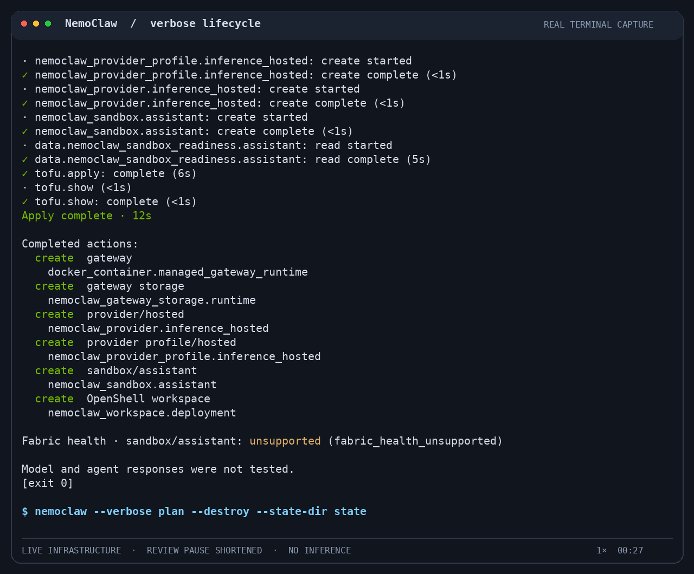

<!-- SPDX-FileCopyrightText: Copyright (c) 2026 NVIDIA CORPORATION & AFFILIATES. All rights reserved. -->
<!-- SPDX-License-Identifier: Apache-2.0 -->

# NemoClaw

## NemoClaw Agent Configs

Configure and deploy sandboxed AI agents from a YAML file.
Choose agents, models, tools, and network access, then preview and apply deployment changes through the CLI or Rust SDK.

This development branch currently requires [building from source](docs/build-deploy/build.md).

### What You Can Do

| Capability | Current support |
|---|---|
| Run OpenClaw or Hermes | Deploy each agent in an OpenShell sandbox and connect through its [native interfaces](docs/agents-inference/interfaces.md). |
| Choose model connections | Connect to hosted endpoints or run managed vLLM and Ollama services; see [inference configuration](docs/agents-inference/inference.md) for supported paths. |
| Supply skills and tools | Load [skill folders](docs/agents-inference/agents.md#skills-on-a-mounted-volume), configure supported native settings, and connect [MCP servers](docs/agents-inference/agents.md#additional-agent-integrations). |
| Control access | Declare [network policy](docs/security/sandbox-network.md) and route [API credentials](docs/agents-inference/agents.md#key-authenticated-apis) through OpenShell. |
| Keep agent files | Use [mounted storage](docs/build-deploy/state.md#keep-agent-files-on-mounted-volumes) for files that must survive sandbox replacement; retaining files alone does not resume a conversation. |
| Manage several agents | Define [separate sandboxes](docs/build-deploy/usage.md#configure-sandboxes-and-inference) with shared or separate model connections. |
| Automate deployments | [Preview, apply, export, and remove deployments](docs/build-deploy/usage.md) through the CLI or [Rust SDK](docs/references/sdk.md). |

Support depends on the selected agent, image, model, and platform; check [current limits](docs/resources/limits.md) before choosing a configuration.

**Coming from Classic?** Use the [migration guide](docs/get-started/migration.md) to assess your workflows and evaluate a separate deployment while keeping your existing setup available.
The guide also identifies [questions that still need scope analysis](docs/get-started/migration.md#needs-scope-analysis).
Track remaining parity work in [Roadmap: Bring agreed Classic features to v1](https://github.com/NVIDIA/NemoClaw/milestone/14).
Broader release preparation is tracked separately in [Roadmap: GTC DC 2026](https://github.com/NVIDIA/NemoClaw/milestone/12).

### Watch a Deployment

[Watch the 43-second demo](docs/assets/terminal-lifecycle-verbose.mp4): a real OpenShell gateway and OpenClaw sandbox lifecycle with `--verbose`.
Images are cached; no inference requests are sent, and only the plan-review pause is shortened.

## Start Here

- [Understand NemoClaw](docs/about/overview.md).
- [Get started with NemoClaw Agent Configs](docs/get-started/first-deployment.md).
- [Build a native bundle](docs/build-deploy/build.md).
- [Configure and operate a deployment](docs/build-deploy/usage.md).
- [Use the SDK](docs/references/sdk.md).
- [Browse all documentation](docs/README.md).

## Contribute

Read the [accepted scope](internal-docs/design/scope.md) and follow [AGENTS.md](AGENTS.md) for repository workflow and required checks.
Follow [WRITING.md](WRITING.md) for explanatory text and the [documentation contributor guide](internal-docs/contributing/documentation.md) for documentation changes.
Report potential vulnerabilities through the private channels in [SECURITY.md](SECURITY.md).

## Licenses

Original NemoClaw code uses [Apache-2.0](LICENSE).
