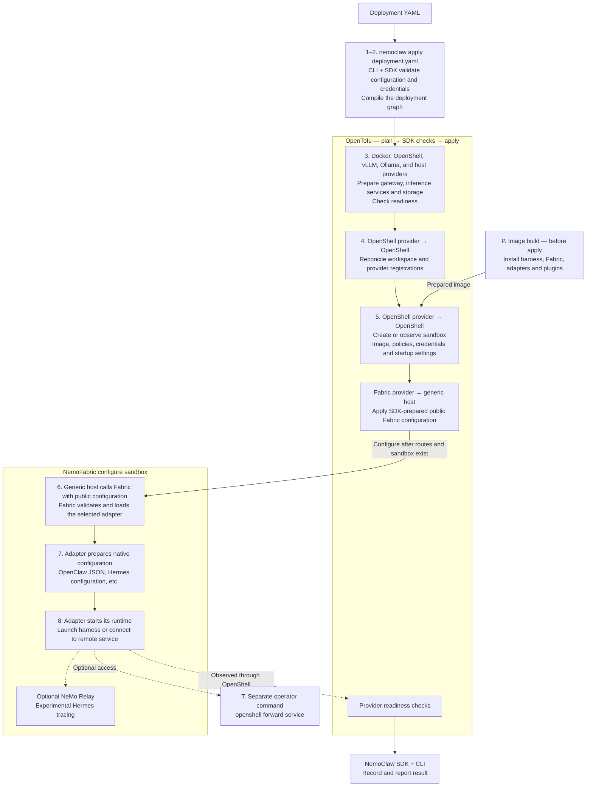

<!-- SPDX-FileCopyrightText: Copyright (c) 2026 NVIDIA CORPORATION & AFFILIATES. All rights reserved. -->
<!-- SPDX-License-Identifier: Apache-2.0 -->

# Apply Flow

`nemoclaw apply deployment.yaml` validates desired state, reconciles infrastructure through OpenTofu, and checks the resulting deployment.
The diagram shows the main managed-deployment path and the configuration handoff to the agent harness.
Use the [architecture guide](architecture.md) for ownership, resource lifetimes, and recovery rules.

## Plan and Apply

A deployment is one OpenTofu configuration that follows **plan → SDK checks → apply**.
OpenTofu compares the configuration with observed resources, the SDK checks the proposed actions, and providers execute the accepted plan.
Independent resources can reconcile concurrently; the numbered steps summarize dependencies rather than individual callbacks.

Running `nemoclaw plan deployment.yaml` first is optional.
That command previews changes without changing runtime resources, although it can write local intent and plan files.
On a fresh managed deployment, the plan includes the gateway and every object it will serve; gateway checks that need the running gateway move to apply.
`nemoclaw apply` generates and checks a fresh plan itself.
See the [CLI reference](../reference/cli.md) for command options.

## Component Flow

The “NemoFabric configure sandbox” group runs inside the OpenShell sandbox.
NemoClaw prepares Fabric's input, and Fabric delegates harness setup to the selected adapter.
OpenShell owns sandbox creation and policy enforcement.

## Steps

| Step | What happens |
|---|---|
| **P. Image preparation** | The image build installs the harness, Fabric, adapters, and packaged native plugins, including OpenClaw Brave and Tavily. Apply uses the prepared image's immutable digest. |
| **1–2. Validate and compile** | The CLI acquires required credential values. The SDK validates configuration, locks deployment state, checks identity and recovery constraints, and compiles one graph: the runtime, OpenShell resource dependencies, sandbox policy, and startup settings. |
| **3. Runtime prerequisites** | Providers reconcile the declared gateway, inference services, storage, and networks. Provider data sources check gateway compatibility and service readiness before any OpenShell or Fabric object changes. |
| **4. OpenShell registrations** | The OpenShell provider reconciles the workspace, provider profiles, and credential-bearing provider registrations. Gateway version and compute-driver checks gate deployment mutations. |
| **5. Sandbox reconciliation** | The OpenShell provider sends OpenShell the image, network and filesystem policy, provider attachments, launch command, and environment. Existing bindings are observed; a changed sandbox specification or agent configuration replaces the sandbox. |
| **6. Fabric configuration** | OpenShell starts the generic Fabric host. The Fabric provider's `fabric_agent` resource composes canonical Fabric configuration from its SDK-compiled typed inputs after routes are established; the host validates and starts it through Fabric's public API. |
| **7. Native configuration** | The selected Fabric adapter maps the public configuration into native settings and owns native validation. The NemoClaw host performs no adapter-specific translation. |
| **8. Harness runtime** | The adapter starts its runtime and launches the harness or connects to an independently deployed remote service. The harness uses its installed components and configured settings. |
| **Optional Relay** | Explicitly enabled Hermes Relay tracing runs in process and writes artifacts inside the sandbox. It is an experimental integration. |
| **Agent start and result** | `fabric_agent` starts each new agent through Fabric's `fabric-agent-ctl` once its sandbox is ready. Fabric reports no runtime status or health, so a successful apply does not establish that agents answer. The SDK retains operation state, and the CLI reports the outcome. |
| **T. Port forwarding** | An operator runs `openshell forward service` using a separately configured OpenShell CLI connection. Forwarding to an enabled listener lasts while that foreground command runs. |

The Docker provider owns disposable Docker compute, images, model-cache volumes, and service networks.
The OpenShell provider owns OpenShell operations and gateway installation: Podman gateway processes, gateway initialization and retained bridges, and Kubernetes gateway storage and authentication.
The Fabric provider owns starting and stopping agent runtimes; the vLLM and Ollama providers own model-server contracts, readiness, capacity, and credential storage.
The selected engine, any SSH execution setup, and the harness image are [operator prerequisites](../prerequisites.md).

## Conditions Summarized by the Diagram

- The graph has no runtime resources when neither a managed gateway nor managed inference services are declared.
  An external gateway must already be reachable for planning.
- The deployment graph can also contain an [Ollama proxy](../inference.md#use-external-ollama-through-a-managed-proxy), its credential storage, model observation, and readiness dependencies.
- Each adapter uses `fabric_agent` after sandbox creation and route setup.
  NemoClaw runs one agent runtime per sandbox, so a new agent always gets a new sandbox.
- Fabric reports no runtime status ([NVIDIA/NeMo-Fabric#420](https://github.com/NVIDIA/NeMo-Fabric/issues/420)); a runtime that stops is found at its next invocation.
  See [agent runtimes during apply](../usage.md#agent-runtimes-during-apply).

For native configuration and optional tracing, see [agent runtimes](../agents.md).
For listener setup and forwarding, see [agent interfaces](../interfaces.md).
For partial failure and retry rules, see [deployment recovery](../usage.md#recover-an-interrupted-operation).

## Implementation

- [SDK operation orchestration](../../crates/nemoclaw-sdk/src/deployment/mod.rs) and [runtime binding checks](../../crates/nemoclaw-sdk/src/deployment/runtime.rs).
- [Deployment graph compiler](../../crates/nemoclaw-sdk/src/compile.rs), which joins the [runtime graph](../../crates/nemoclaw-sdk/src/compile_runtime.rs).
- [Harness image build](../../image/fabric/Dockerfile) and [NemoClaw Fabric launcher](../../image/fabric/fabric.py).
- [Fabric adapter implementations](https://github.com/NVIDIA/NeMo-Fabric/tree/main/adapters).
