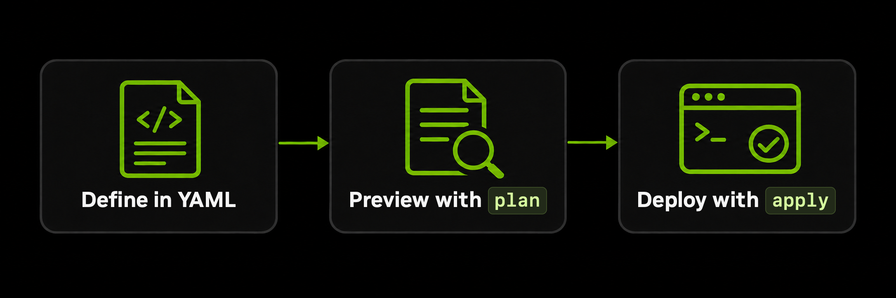

import { BadgeLinks } from "./_components/BadgeLinks";

<BadgeLinks
  badges={[
    {
      href: "https://github.com/NVIDIA/NemoClaw/blob/main/LICENSE",
      src: "https://img.shields.io/badge/License-Apache_2.0-blue",
      alt: "License",
    },
    {
      href: "https://github.com/NVIDIA/NemoClaw/blob/main/SECURITY.md",
      src: "https://img.shields.io/badge/Security-Report%20a%20Vulnerability-red",
      alt: "Security Policy",
    },
    {
      href: "https://discord.gg/XFpfPv9Uvx",
      src: "https://img.shields.io/badge/Discord-Join-7289da",
      alt: "Discord",
    },
  ]}
/>

**NVIDIA® NemoClaw™** is an open source reference stack for running supported AI agents on the OpenShell runtime.
NemoClaw Agent Configs builds on NemoClaw with a reusable configuration and deployment workflow: define deployments in YAML, review the plan, and apply changes through the CLI or Rust SDK.

## Deployment Changes in NemoClaw

NemoClaw v0 supports several agent harnesses and sandboxes, with onboarding and operations tailored to each agent.
NemoClaw Agent Configs (v1) moves deployment from agent-specific commands to a shared YAML workflow.
It uses NeMo Fabric to manage agent runtimes and brings gateway, inference, sandbox, and agent settings together in one reusable configuration.
Across supported harnesses, use the same CLI or Rust SDK to preview resource changes with **`plan`** and deploy with **`apply`**.

Start new deployments with Agent Configs to share a configuration, repeat an evaluation, or compare supported setups.
You can continue using NemoClaw v0, including for workflows that rely on agent-specific features such as guided messaging setup.

<Note title="Transition from V0 to V1">

The transition from NemoClaw v0 to v1 is planned to complete in the first quarter of 2027.
To migrate from v0, follow the [migration guide](https://docs.nvidia.com/nemoclaw/v1/migration) and use a separate deployment.
The [NemoClaw roadmap](https://github.com/NVIDIA/NemoClaw/milestones) tracks planned capabilities.

</Note>

## Get Started

Match the documentation, source, and artifacts to the release you use.
For an existing deployment, check your CLI with `--version` and use the product selector to open the matching guide.
To build a published release from source, check out its release tag.

<Cards>

<Card title="Install NemoClaw Agent Configs (v1)" icon="regular file-code" href="https://docs.nvidia.com/nemoclaw/v1/install">

**Docs and source** · v1 installation guide and `v1` branch.

**Release artifacts** · `v0.1.0` CLI installer or archive, with the configuration schema and agent image from the same release.

</Card>

<Card title="Install NemoClaw v0" icon="solid terminal" href="../openclaw/get-started/quickstart">

**Docs and source** · v0 quickstart for your agent and `main` branch.

**Release artifacts** · the v0 installer and releases in the `0.0.x` series.

</Card>

</Cards>

### From Your Coding Agent

Copy this prompt into your coding agent to use the guide and artifacts that match your deployment.

<Prompt title="Set up NemoClaw with your coding agent">

Help me set up NVIDIA NemoClaw for one task I want an agent to do.
Ask about that task and whether I am setting up a new deployment or working with one I already run.
Check my operating system, architecture, and installed CLI version.
Start with NemoClaw Agent Configs (v1) for a new deployment unless I ask to use v0.
For an existing deployment, use the guide and artifacts for its current release.

- For Agent Configs, follow https://docs.nvidia.com/nemoclaw/v1/install and https://docs.nvidia.com/nemoclaw/v1/get-started. Use a matching CLI bundle, schema, and agent image. Start from the OpenClaw example and show me the YAML and planned changes before applying them. If I already run v0, use a separate deployment and follow https://docs.nvidia.com/nemoclaw/v1/migration.
- For NemoClaw v0, use the v0 installer and `0.0.x` releases. Follow the v0 quickstart for my agent under https://docs.nvidia.com/nemoclaw/v0/user-guide/. Use `openclaw/get-started/quickstart`, `hermes/get-started/quickstart`, or `deepagents/get-started/quickstart` as appropriate.

For a development checkout, use the `v1` branch for Agent Configs or `main` for NemoClaw v0.
To build a published release from source, check out its release tag.
Confirm which deployment I want to work on and ask before installing software or applying changes.
Keep credentials out of chat.
Verify a reply through the agent's native interface.

</Prompt>

---

<Warning title="Notice and Disclaimer">
  This software automatically retrieves, accesses or interacts with external
  materials. Those retrieved materials are not distributed with this software
  and are governed solely by separate terms, conditions and licenses. You are
  solely responsible for finding, reviewing and complying with all applicable
  terms, conditions, and licenses, and for verifying the security, integrity and
  suitability of any retrieved materials for your specific use case. This
  software is provided "AS IS", without warranty of any kind. The author makes
  no representations or warranties regarding any retrieved materials, and
  assumes no liability for any losses, damages, liabilities or legal
  consequences from your use or inability to use this software or any retrieved
  materials. Use this software and the retrieved materials at your own risk.
</Warning>
