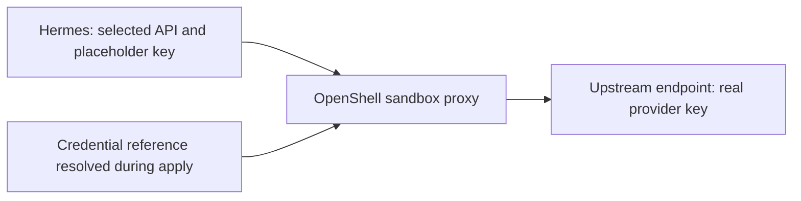

<!-- SPDX-FileCopyrightText: Copyright (c) 2026 NVIDIA CORPORATION & AFFILIATES. All rights reserved. -->
<!-- SPDX-License-Identifier: Apache-2.0 -->

# Configure Inference APIs, Limits, and Authentication

Choose who operates the inference service, then select the API and model used by the agent.
A deployment can select up to 32 inference providers across its sandboxes.
Use a route-inline `provider` or select an enclosing `inferenceProviders` definition with `providerRef`; see [definitions and references](configuration-references.md).

Use current images and verify your chosen harness and model; passing tests for one combination do not qualify another.

For each selected provider, NemoClaw creates an owned profile binding credentials to its host, port, and API path, attaches the provider to the sandbox, and configures native model connections.
For uncredentialed endpoints, a dummy client key satisfies SDKs that require a nonempty key; no provider credential is stored.
The model ID is client configuration, not a proxy-enforced model restriction; the attached provider authorizes its configured API path.
The YAML `routes` field names model configuration; it creates no OpenShell route resource.

## Give an Agent Multiple Model Choices

Declare model choices for an adapter that advertises native model selection.
The SDK preserves the choices; parser acceptance does not establish native model-switching support.
Declare named `inference.routes` and set `inference.default` to the initial choice when there is more than one route.
Omitting `default` selects the sole route; duplicate names and missing defaults are errors.
Use `inferenceRef` to reuse the whole selection without repeating it.

The [multiple-model example](../examples/multiple-models.yaml) gives a researcher smart and fast choices and a writer only the fast model.
It assumes an existing endpoint serving both model IDs; it does not provision that server or download either model.
Select a gateway, current agent image, endpoint, and models using the prerequisites below before applying it with a fresh deployment UID and state directory.

The SDK preserves named models and maps the selected initial route to the public Fabric `default` model role.
Fabric owns native aliases and model-selection behavior; OpenShell enforces provider access at the sandbox boundary.
This configuration supplies no automatic fallback, consultation between models, or agent delegation behavior.
Apply installs provider attachments and checks the declared agent configuration without requesting model responses.
Missing credential references still fail deployment; actual endpoint authentication and model compatibility require explicit inference verification.
Use native requests to verify model selection through the agent interface separately.
Parser and native configuration tests do not establish model quality or live-provider compatibility.

An inference definition accepts up to 32 named routes.
That structural limit does not establish that an adapter can switch models.
The SDK preserves native reasoning identifiers without treating them as advertised capabilities.
An option without a confirmed mapping to the selected Fabric adapter remains unverified.
Native reasoning changes remain an adapter operation.
Each managed `service` serves one pinned model; routes must use its declared served model.
An Ollama proxy also selects one externally managed model.
Additional models can use external providers alongside that managed provider.
Changing model configuration reconciles the owned agent-configuration resource and restarts the runtime inside the existing sandbox when provider attachments and sandbox policy remain unchanged.
For Pi, see [model selection and updates](agents.md#pi-model-selection).

## Combine Local and Hosted Providers

The [multiple-provider example](../examples/multiple-providers.yaml) gives a researcher a hosted smart model and a local fast model; the writer selects only the local model.
Each route selects its own `provider` or `providerRef`, with that provider's API and credential reference.
The sandbox attaches the union of those selections, deduplicated by definition identity.
Unused inference provider definitions add no resources, credential requirements, or network grants.
Services declared under `spec.services` are installed and checked independently of provider selection.
Selected definitions must have distinct provider names within their [definition scope](configuration-references.md).
Different sandboxes can reuse local provider names.

Replace the example endpoints, model IDs, deployment UID, and image for your environment.
The local server and hosted API must already exist and satisfy the [external endpoint prerequisites](#prepare-an-external-endpoint).
Set `HOSTED_API_KEY` on the applying host; requests to a real hosted API may incur charges.
Use the [deployment workflow](usage.md) with fresh state, then verify each configured model through its native agent interface.

OpenShell receives a distinct provider credential key for each credentialed registration; the sandbox receives placeholders rather than the resolved upstream keys.
Every attached provider is available at the sandbox boundary.
Each agent runs in its own sandbox; its model-selection policy does not further restrict credentials or network access for other processes in that sandbox.
Use separate deployments when you need independent teardown.
NemoClaw observes the full attachment set and rejects missing or unexpected attachments.

Declare multiple named Ollama or vLLM services with independent retained storage.
Providers reference a service by name with `serviceRef`; multiple providers can share the same service.
vLLM supports separate generated credentials through `spec.services.<name>.authentication: bearer`.
Services on the same engine require distinct publication addresses and the same managed network CIDR.
Each runtime checks available memory before starting inference and retains resident protection.
Plan does not reserve shared GPU capacity or sum live startup demand; choose service budgets for the host's combined workload.
An existing GPU process alone does not reject startup when measured capacity is sufficient.
The installer performs one bounded readiness check after installation. It does not add service start, stop, restart, recovery, or continuous-monitoring operations.
Multiple sandboxes can share any selected provider.
Managed vLLM resource identities include the service name.
The current tests establish configuration, compilation, API attachment, and drift behavior against fixtures; live multi-provider qualification remains separate.

## Choose a Service Mode

| Situation | Configuration and owning guide | Example to adapt |
|---|---|---|
| You already operate a compatible endpoint or have a hosted API | External `endpoint`, matching `provider`/`api`, and a credential reference when required | [OpenClaw external endpoint](../examples/inference-tuning.yaml), [Hermes authentication](../examples/hermes-auth.yaml) |
| NemoClaw should run Ollama on a declared NVIDIA GPU | Declare a service with `kind: ollama`, hardware requirements, a pinned runtime image, a model name and digest, memory, and serving settings | [Managed Ollama](#run-managed-ollama) |
| Ollama and its model already run locally and must remain external | Declare a service with `kind: ollamaProxy` to manage an authenticated proxy for one installed model digest | [Proxy configuration](#use-external-ollama-through-a-managed-proxy) |
| You run a model server in a Kubernetes or OpenShift gateway's cluster | External `endpoint` naming its Service, `http://<service>.<namespace>.svc.cluster.local:<port>/v1`, and an optional credential reference; follow [in-cluster model servers](kubernetes.md#use-a-model-server-in-the-cluster) | [In-cluster vLLM](../examples/kubernetes/in-cluster-vllm.yaml), [in-cluster Ollama](../examples/kubernetes/in-cluster-ollama.yaml) |
| NemoClaw should download and serve a pinned public model with vLLM | Declare a service with `kind: vllm`, the runtime image, repository revision, capacity, and serving settings; see [managed models](models.md) | [Generic vLLM](../examples/spark/vllm.yaml) |
| The Docker daemon running a managed service is reached through SSH | Set `placement.engine` to the SSH endpoint, then declare the private network and `publication` endpoint on the named service; follow [remote service](remote-service.md) | [Remote vLLM](../examples/spark/remote-vllm.yaml) |
| The model requires preparation tools or runtime patches | Package reviewed tools in an immutable image and declare an [inline recipe](recipes.md) | [Inline Qwen3.8 recipe](../examples/spark/spark-inline.yaml) |

Service ownership does not depend on the harness; the service must support the [request API](#choose-the-request-api) selected by that harness.
The [harness matrix](reference/fabric-harnesses.md) distinguishes accepted configurations from live qualification.
Examples use the SDK default image or an explicit image digest, plus deployment identities and environment-specific endpoints.
Build/select your own matching images and replace those values before use.
An accepted example is a configuration contract, not evidence that the combination completes live inference.

## Set Container Limits and Update Policy

Managed `kind: vllm` and `kind: ollama` services use `container` for CPU and system-memory limits on Docker.
Set these fields under the service, alongside its model and serving settings:

```yaml
# Under spec.services.<name>:
container:
  cpuLimitMillis: 4000
  memoryLimitGiB: 64
updatePolicy: Preserve
```

`cpuLimitMillis: 4000` caps CPU use at four cores; `memoryLimitGiB` limits the container's system memory.
These fields do not set the GPU budget: `memory.gpuMemoryGiB`, `memory.gpuMemoryUtilization`, and backend-specific cache settings retain their runtime meanings.
The runtime's resident host-memory monitor reads `/proc`, not cgroup memory pressure, so the kernel can OOM-kill a container that reaches `memoryLimitGiB` before the monitor stops inference.
Docker defaults to a 104 GiB memory limit and no CPU cap when these limits are omitted.
Native managed inference on Podman remains unsupported; a Podman gateway can consume a service on an explicitly selected remote Docker engine through [SSH placement](remote-service.md).
These shared fields do not change [platform qualification limits](limits.md#platforms-models-and-placement).

The service-level `updatePolicy` defaults to `Preserve`.
For Docker, this refuses an update that would replace a running managed model container.
Changing the image, model, serving settings, `cpuLimitMillis`, or `memoryLimitGiB` replaces the container; declaring the omitted 104 GiB default as `memoryLimitGiB: 104` does not.
Earlier bundles replaced a running Docker model container for image, model, and serving changes without a policy; to keep that behavior, for example when automation updates images, set `spec.services.<name>.updatePolicy: Recreate`.
Set `updatePolicy: Recreate` only when accepting sequential replacement and possible downtime if the replacement cannot start.
The opt-in persists for later updates until removed or changed to `Preserve`; changing only this policy does not restart the workload.
Initial creation, unchanged apply, and recovery of missing or stopped Docker containers remain allowed after ownership checks.
Retained model data and credentials remain bound to the deployment.
This policy applies to managed vLLM and Ollama, not the Ollama proxy or gateway; see [change constraints](usage.md#choose-the-change-path).

## Choose the Request API

Set `api` on the selected provider, whether inline or referenced, to the request API your endpoint accepts.
OpenShell authorizes native endpoint access and substitutes the provider credential; selecting an API does not translate requests into a different protocol.

| Provider transport | API when omitted |
|---|---|
| `openai` | `openai-completions` |
| `anthropic` | `anthropic-messages` |

An explicit `api` can select `openai-completions`, `openai-responses`, or `anthropic-messages` with the matching provider transport.
NemoClaw uses it to read the endpoint's model catalog.
The harness name does not change these defaults.

Agents use the protocol their harness's adapter selects for the provider transport.
Fabric v0.5.0 has no per-model API setting, so an endpoint that accepts only a protocol the adapter doesn't select can't serve that agent ([#13320](https://github.com/NVIDIA/NemoClaw/issues/13320)).
Fabric validates the rest of its configuration when the agent is configured.

Use `provider: anthropic` with `anthropic-messages` and `provider: openai` with either OpenAI API.
The provider name is the local reference used by routes; it does not select a vendor.
For example, a Nous endpoint using the OpenAI protocol still uses `provider: openai`.

### Prepare an External Endpoint

Before writing its provider declaration, obtain the base URL, API, exact model ID, required credential, and model limits from the endpoint operator.
Confirm that the selected image's Fabric descriptor accepts that API.
Catalog metadata and `/models` responses do not establish successful inference.
For a credentialed endpoint, declare an environment reference; [credential ownership](security.md#credentials-and-authentication) describes where the resolved key persists.
Prefer HTTPS: over plain HTTP, the key crosses the network unencrypted.
OpenShell decides which inference destinations a sandbox can reach.

The endpoint must be reachable from the sandbox's OpenShell proxy, not just from your client terminal.
A loopback URL refers to the network namespace making the request.
For a local external Ollama daemon, use the [managed proxy](#use-external-ollama-through-a-managed-proxy) contract instead of assuming that the gateway can reach the client's loopback interface.

Use the route's `overrides.model` for the upstream model ID.
Native agents send the configured model ID to the native endpoint using an OpenShell placeholder credential; they do not need the real upstream key in their YAML or sandbox environment.
Confirm a native agent reply after apply using [verification levels](#verify-the-result).
Guides for named hosted providers are tracked in [#12038](https://github.com/NVIDIA/NemoClaw/issues/12038).

### Trust a Custom Certificate Authority

An endpoint whose certificate comes from an internal certificate authority, such as an organization's LiteLLM proxy, needs that CA trusted in two places:

- **The machine running NemoClaw** reads the endpoint's model catalog during onboarding, using its system trust store.
  Add the CA there, or set `SSL_CERT_FILE` to a PEM bundle that includes it in the environment that runs `nemoclaw`.
- **The OpenShell gateway and sandboxes** carry the inference traffic, so their images must trust the CA too.
  NemoClaw does not configure that trust; OpenShell uses its images' own trust stores.

If the machine running NemoClaw does not trust the certificate, onboarding reports that the server's certificate is not trusted rather than that the endpoint is unreachable.

## Use an Image Built from This Revision

Explicit API selection, tuning, and authentication require an agent image built from this revision; [build it](build.md#build-agent-images) and use its immutable digest in `sandboxes[].image.ref`.
The [tuning example](../examples/inference-tuning.yaml) and [Hermes authentication example](../examples/hermes-auth.yaml) contain zero-digest placeholders that must be replaced before deployment.
Set their gateway and inference endpoints and model IDs for your services, and assign a fresh deployment UID.
Model and native settings changes restart the runtime inside the existing sandbox; changing its image requires a separate deployment, as described in [the change path](usage.md#choose-the-change-path).

## Run Managed Ollama

Declare `kind: ollama` under `spec.services` to run Ollama through the same package-independent installer contract as vLLM.
The [GPU example](../examples/managed-ollama-gpu.yaml) selects DGX Spark and a pinned public Qwen3 model.
Before applying, choose a fresh deployment UID and state directory, a current agent image, and a hardware profile matching the inference host.
The inference host needs Linux, Docker with NVIDIA container GPU access, one observable NVIDIA GPU, and enough host/GPU memory and disk for the declared budget.
Use the [hardware profile reference](models.md#choose-a-hardware-profile) for other GPU families and explicit CPU architecture.
Local placement uses the managed gateway's Docker engine; [SSH placement](remote-service.md) uses the same `placement` and `publication` fields as vLLM.

Build the supervisor image from this checkout using the [runtime build prerequisites](build.md#build-a-runtime-image).
From the repository root, on a Linux ARM64 or AMD64 build host matching the model host:

```sh
cargo run -p nemoclaw-build --no-default-features -- runtime runtimes/ollama/build.json
```

The command builds and loads a local image for the build host's architecture and retains its OCI archive under `.build/ollama`.
Use the immutable image digest from that build in `spec.services.<name>.image` and make the image available on the selected engine.
The example image digest is a placeholder; a bare upstream `ollama/ollama` image lacks the required supervisor.
The [runtime notice](../runtimes/ollama/NOTICE.md) identifies the pinned upstream image and retained sources.

The provider uses `provider: openai` and `api: openai-completions`.
Select an adapter whose Fabric contract accepts that protocol.
Omit the provider's `endpoint` and `credential` when using `serviceRef`.
The service publishes its private `/v1` endpoint through the shared placement contract.
Ollama has no native bearer authentication in this adapter; restrict access through the host's existing network controls.

```yaml
# Under spec:
services:
  qwen:
    kind: ollama
    hardware: {profile: dgx-spark}
    image: nc-prototype-ollama@sha256:REPLACE_WITH_RUNTIME_DIGEST
    model:
      name: qwen3:0.6b
      digest: 7df6b6e09427a769808717c0a93cadc4ae99ed4eb8bf5ca557c90846becea435
    serving:
      contextTokens: 32768
      maxSequences: 1
    memory:
      gpuMemoryGiB: 16
inferenceProviders:
  - name: qwen
    provider: openai
    api: openai-completions
    serviceRef: qwen
```

Set the route's `overrides.model` to the same `model.name`.
The model digest is the SHA-256 of the registry manifest, not the GPU runtime image or an individual weight blob.
For a different public library model, obtain and inspect its registry manifest and license before pinning its digest.
The resolver accepts exactly one model layer plus optional template, license, parameters, and system layers.
Projector and adapter layers, private registries, and non-library names are rejected.
Model parameters may supply sampling defaults; resource overrides such as `num_ctx` or `num_gpu` are rejected so they cannot override the service limits.
For example, these commands download only Qwen3 metadata into the current directory:

```sh
curl --fail --silent --show-error https://registry.ollama.ai/v2/library/qwen3/manifests/0.6b -o ollama-model-manifest.json
sha256sum ollama-model-manifest.json
```

During startup, the hosted runtime resolves uncached manifest and parameter metadata and rejects a tag whose manifest differs from `model.digest`.
It checks hardware compatibility and declared GPU/host budgets.
Plan does not query the model registry or run the SSH host collector.
The Ollama weight-size check is a lower bound: all snapshot bytes plus 2 GiB must fit the declared GPU budget.
Plan does not load the model or establish that its context and native KV cache will fit.

Apply downloads and verifies the native registry manifest and each blob using the shared resumable snapshot path.
It then starts Ollama, checks the selected digest, and sends a load-only request without a prompt or generated response.
The bounded readiness check requires Ollama to report the selected model fully on GPU, within the configured memory budget, and with the requested context length.
These checks are observations, not a hard GPU allocator quota; a model may exceed its budget during loading before the check fails.
CPU offload is rejected; multi-GPU execution and CPU-only execution are not part of this shared adapter yet.

Ollama sizes its KV cache and batching natively.
Nonzero `kvCacheGiB` or `batchTokens`, vLLM parser/compilation settings, inline recipes, model aliases, and native bearer authentication are rejected.
Context and concurrency use the common `serving.contextTokens` and `serving.maxSequences` fields.
A dedicated-memory profile can use the common `gpuMemoryUtilization` setting with an explicit minimum GPU memory requirement.

Use the [plan/apply/export workflow](usage.md) with the adapted complete example.
A failed startup retains provider state, the model volume, and status for inspection; correct the failure and reapply.
Recovery may replace the container while reusing that volume.
Destroy removes owned runtime resources and retains the model volume.
Verified cached snapshots can be reused without querying a subsequently changed registry tag.

Configuration, registry download, startup protocol, memory checks, and removal behavior are covered by fixtures.
Live image builds, GPU inference, tools and agent replies with this adapter have not been tested ([#12641](https://github.com/NVIDIA/NemoClaw/issues/12641)).

## Authenticate a Managed vLLM Service

Set `authentication: bearer` under `spec.services.<name>` to generate a private key for a managed vLLM service.
Omission preserves the existing unauthenticated serving behavior.
Build the [runtime image](build.md#build-a-runtime-image) from this revision and use its immutable digest.
Authenticated services require both `org.nemoclaw.inference.authentication=bearer-v1` and `org.nemoclaw.inference.routes=openai-v2`; image validation rejects other images before creating the runtime, including `openai-v1` images from earlier revisions, whose middleware passed every `/v1` path.
Do not supply `inferenceProviders[].credential` for a managed service.

The supervisor creates a mode-0600 key in `/credentials/inference-key` on a separate credential volume under its own writer lock and reuses it after restart.
It passes the key only to the vLLM child process through `VLLM_API_KEY`, then verifies `/v1/models` through the route filter below, using bearer authentication, before reporting readiness.
Recipe environment maps cannot set `VLLM_API_KEY`.
The OpenShell provider reads the key through the verified runtime container identity and installs it in OpenShell's provider credential store.
Agent requests use their OpenShell placeholder credential.
YAML, plans, container launch settings, and OpenTofu state contain no generated key.
The runtime's root user and Docker administrators can read the key and child environment.
The key authenticates the `/v1` requests below and does not provide TLS.
In bearer mode, the supervisor serves the published port with HTTP/1.1 and forwards only these requests to vLLM:

- `GET /v1/models` and `POST` to `/v1/chat/completions`, `/v1/completions`, `/v1/responses`, `/v1/messages`, or `/v1/messages/count_tokens`, each of which requires the key.
- `GET /health`, which is public.

vLLM listens only on `127.0.0.1` inside the container, at the port after `serving.port`, or at 65534 when `serving.port` is 65535.
The supervisor compares the method and the path exactly as sent, without decoding or normalizing the path.
It forwards the query string and end-to-end headers, including `Authorization`, removes hop-by-hop headers such as `Connection`, and streams request and response bodies.
Because vLLM's server trusts forwarding headers from loopback, the supervisor replaces `X-Forwarded-For` with the connecting address and removes `X-Forwarded-Proto`; vLLM's access log shows that address with port 0.
Every other request returns HTTP 404 with `{"error":"Not found"}` before reaching vLLM, with or without the key, and the supervisor does not log it.
This includes `POST /invocations`, `OPTIONS` requests, `HEAD /health`, dot-segment or percent-encoded spellings such as `/v1/../invocations` and `/v1/%6Dodels`, a trailing slash such as `/v1/models/`, absolute-form request targets, requests that offer a protocol upgrade, such as WebSocket or the h2c offer of `curl --http2`, and management routes that recipe `VLLM_*` variables can enable, such as `/v1/load_lora_adapter`.
An allowed request returns HTTP 400 with `{"error":"Bad request"}` when its body cannot be read, such as invalid chunked framing, and HTTP 502 while vLLM is not accepting connections.
A client must send its request headers within 30 seconds.
A client that closes its sending side before the response arrives is treated as disconnected.
The supervisor serves at most 256 connections at a time, or fewer when the container's maximum open-file limit is below 640; later connections wait to be accepted.
If the route filter fails, the supervisor stops vLLM and reports the failure.
This restriction closes an upstream gap: the [native vLLM authentication middleware](https://github.com/vllm-project/vllm/blob/v0.32.0/vllm/entrypoints/serve/middleware/authenticate.py) leaves `/invocations` unguarded, and an operator's test of an earlier image returned a chat completion through that route without a key.
Omitting `authentication: bearer` leaves the upstream route behavior unchanged; vLLM then serves the published port itself.
Keep the whole listener on a trusted private network, including when `authentication: bearer` is enabled.
For Docker, restrict access through the host's network controls.

Destroy removes the runtime and provider registration and retains the separate model and credential volumes.
Recreation using the retained credential volume reuses the key.
A missing key after initialization or invalid key metadata stops startup and retains storage for inspection.
Retire model data and credentials separately; removing the model volume does not erase the credential.
To retire both with the deployment, see [Remove Retained Resources](usage.md#remove-retained-resources).
Changing an existing service to enable authentication follows the normal runtime replacement rules; YAML does not reconfigure a running server in place.

### Supply the Key on Other Platforms

The generated key lives in a Docker volume, so NemoClaw generates keys only for services it places on Docker.
On another platform, such as Kubernetes or Podman, supply the key yourself and keep it in the platform's secret store.
With `authentication` set, `vllm_runtime`'s `launch.key_env` names the variable to set, `NEMOCLAW_INFERENCE_KEY`.
When it is set, the runtime uses that key instead of generating one, needs no credential volume, and passes the key to vLLM only as `VLLM_API_KEY`.
The key must be 16 to 4096 printable characters without whitespace.
A supplied key without `authentication` stops startup, so the server never runs unauthenticated by mistake.

On Kubernetes, for example, store the key in a Secret and set the variable from it:

```yaml
env:
  - name: NEMOCLAW_INFERENCE_KEY
    valueFrom:
      secretKeyRef:
        name: vllm-inference-key
        key: key
```

Register the server with OpenShell using the same key: give `openshell_inference` a `server` object whose `credential_env` names a variable holding the key where OpenTofu runs.
Readiness on those platforms is the platform's job; point its readiness probe at `GET /health`, which needs no key.
In YAML, set the provider's `credential` to that variable; [Use a Model Server in the Cluster](kubernetes.md#use-a-model-server-in-the-cluster) shows a Kubernetes example.

## Use External Ollama through a Managed Proxy

Run the proxy on the same Linux Docker host as the existing Ollama daemon and installed model.
With a managed Docker gateway, the proxy inherits `gateway.engine`.
With an external gateway, declare the proxy service's `engine` as an explicit local Docker Unix socket and make its published endpoint reachable from OpenShell.
Ollama must listen only on a loopback address.
NemoClaw observes its model inventory and never installs, stops, or deletes the daemon or model.
The proxy exposes `openai-completions`; its service contract does not restrict the harness identifier.
The selected adapter must accept that protocol and model configuration.

Use a Docker image store that records a repository digest for locally built images, as described in the [image build prerequisites](build.md#build-agent-images).
Build the proxy image from the repository root, explicitly selecting the native host platform (`linux/arm64` below, or `linux/amd64`):

```sh
AGENT_PLATFORM=linux/arm64 docker buildx bake ollama-proxy --load
docker image inspect nc-fabric:ollama-proxy --format '{{index .RepoDigests 0}}'
```

Use the printed immutable image reference below, choose an available private proxy address reachable by OpenShell, and replace the model digest with the lowercase 64-character value reported by Ollama's `/api/tags` API:

```yaml
# Under spec:
services:
  local:
    kind: ollamaProxy
    image: nc-fabric@sha256:REPLACE_WITH_IMAGE_DIGEST
    endpoint: http://172.20.0.1:11435/v1
    upstream:
      endpoint: http://127.0.0.1:11434/v1
      model:
        name: qwen3:4b
        digest: REPLACE_WITH_MODEL_DIGEST
inferenceProviders:
  - name: local
    provider: openai
    serviceRef: local
```

The service's `upstream.endpoint` identifies the external daemon; its `endpoint` identifies the managed proxy and supplies the native inference URL.
The route's model must match `upstream.model.name`, including its tag, such as `qwen3:4b`.
The proxy uses the host network and checks that the daemon has no listener on a non-loopback address.
Do not declare `endpoint` or `credential` on this provider; the referenced service supplies its connection and generated credential.
The service declaration manages only the proxy; its upstream daemon and model remain external.

The proxy generates a private bearer key in its owned credential volume and reuses it after restart or recreation.
NemoClaw reads that key through the verified container identity when registering the OpenShell provider.
The key does not enter YAML, plans, container launch settings, or OpenTofu state, and the proxy never forwards it to Ollama.
The container's root user and Docker administrators can read its credential volume.
The private HTTP endpoint relies on its configured host-network reachability; it does not provide TLS.

Authenticated access is limited to the selected model through `/v1/models` and `/v1/chat/completions`, including streaming responses.
The proxy verifies the model digest before each request and blocks changed or absent models.
It exposes no model-management API.
Plan and export also reject changed model digests and preserve prior bindings.
Restore the pinned external model before retrying, or use a fresh deployment to select a different installation.

An explicit apply can reconcile an owned, stopped proxy after its external model passes observation.
A missing or insecure retained key stops startup; it is never regenerated beside initialized storage.
Destroy removes the proxy and OpenShell registration and retains the credential volume; the external daemon and model remain untouched.
Reapplying the original configuration reuses that retained key.
When retiring the deployment, remove the retained credential volume with [Remove Retained Resources](usage.md#remove-retained-resources).

## Tune OpenClaw's Primary Route

Set the public model output limit with `maxTokens`.
The [tuning example](../examples/inference-tuning.yaml) uses:

```yaml
overrides:
  model: example-reasoning-model
  maxTokens: 8192
```

A route can also set `temperature` and `topP`, which the SDK passes to Fabric's `temperature` and `top_p`.
`harnessProvider` sets the Fabric model provider the harness uses; without it, the SDK uses the inference provider's API family, `openai` or `anthropic`.
For example, Hermes's `custom` provider turns reasoning off by default, which a hosted reasoning model may need to answer within Fabric's invocation deadline.
Fabric validates these values when it configures the agent.

The pinned OpenClaw adapter takes no native model settings, so its routes leave `overrides.settings` unset.
For adapters that take them, the SDK forwards `settings` unchanged into the public Fabric model configuration, keeping nested null values intact.
The selected adapter's model schema and implementation own the meanings, accepted values, and defaults.
These settings do not resize a managed inference server; configure that service's limits separately.
The SDK does not infer native support from an adapter name or from accepting the YAML structure.

The managed Ollama examples for OpenClaw set the service's `serving.contextTokens` to `32768`.
The [managed Hermes example](../examples/managed-hermes.yaml) sets `65536`, because [Hermes needs at least `64000`](#size-the-context-for-hermes).
An operator-reported OpenClaw prompt used 19,947 tokens in one setup, before allowing space for a reply.
Size the model, KV cache, and GPU memory for the selected context.
The OpenClaw adapter owns how it uses the context window; NemoClaw does not assess an OpenClaw route's context budget.

## Size the Context for Hermes

The pinned Hermes Agent requires a model context window of at least 64,000 tokens.
It reads the window from the model server; route settings do not change it.
For a Hermes route to managed vLLM or Ollama, set `serving.contextTokens` between `64000` and the schema maximum, `65536`, and choose a model that supports that context.
The [managed Hermes example](../examples/managed-hermes.yaml) serves `nemotron-3-nano:4b`, whose 256K-token native window covers that range.
`qwen3:0.6b` and `Qwen/Qwen3-4B`, used by the other managed Ollama examples and the [Spark vLLM example](../examples/spark/vllm.yaml), have 40,960-token native windows and cannot serve Hermes.
In one operator test, Hermes answered a request through cluster vLLM serving `Qwen/Qwen3-4B-Instruct-2507` with `serving.contextTokens: 65536`; that test does not qualify the model.

NemoClaw doesn't check the window for Hermes.
Hermes checks the window the model server reports when the agent starts, and its error names the server setting to raise, which for a managed service is `serving.contextTokens`.
Ollama reports the model's native window rather than `serving.contextTokens`, so Hermes doesn't reject a smaller managed Ollama window, and longer conversations are cut off at that window instead ([current limits](limits.md#inference)).

## Authenticate Hermes through the Provider

Declare an external HTTPS provider with a credential reference, then select it from the route and enable Hermes authentication:

```yaml
# Under spec.inferenceProviders:
- name: nous
  provider: openai
  api: openai-completions
  endpoint: https://inference-api.nousresearch.com/v1
  credential:
    env: NOUS_API_KEY

```

On the Hermes agent:

```yaml
auth:
  method: api-key
inference:
  routes:
    - name: primary
      providerRef: nous
      overrides:
        model: moonshotai/kimi-k2.6
```

Supply `NOUS_API_KEY` to the applying process through your secret-management mechanism.
The SDK resolves the reference and supplies the credential to the OpenShell provider.
Hermes sends requests to the selected provider endpoint using an endpoint-bound sandbox placeholder key; the real upstream key is not added to its launch environment or exported YAML.
Authentication derives its provider from the primary route, including when that provider is inline.
The selected provider must carry a credential.
That provider may also use a generated credential from a [managed vLLM service](#authenticate-a-managed-vllm-service) or [Ollama proxy](#use-external-ollama-through-a-managed-proxy).
Interactive Hermes login and separate authentication providers are unsupported.

The gateway retains the provider credential until the owned provider is removed or updated.
Destroy removes the owned provider registration; it does not revoke the upstream key.
Export and destroy do not require resolving the inference key again.
Remove the applying process's environment value when finished, and revoke the upstream key through its issuer when appropriate.



## Share a Gateway across Deployments

Each deployment UID derives a distinct OpenShell workspace containing its provider profile, provider registration, and sandbox.
Separate YAML files with fresh UIDs and separate state directories can use the same external gateway with separate provider attachments.
Use the gateway operator's authorization for each workspace and [select the matching workspace](interfaces.md#select-the-gateway-and-workspace) for native access.
Giving two documents the same UID does not create independent deployments.

Use checked `nemoclaw export` to inspect provider, sandbox, and native agent configuration against retained intent.
Observed provider or public-configuration mismatches can produce drift; they are not a NemoClaw reconnect or model-switch procedure.
Native file changes require an owner observation contract and are not detected by comparing remembered public configuration.
Follow [the change path](usage.md#choose-the-change-path) to update desired state and verify a reply afterward.
The [compiler](../crates/nemoclaw-sdk/src/compile.rs) and [resource mutation](../crates/openshell-provider/src/mutation.rs) define workspace ownership.

## Understand Timeout Budgets

Choose the budget for the phase that failed; extending an agent turn does not extend model loading or readiness.

| Phase | Current budget and setting |
|---|---|
| Fabric runtime request | `harness.execution.timeoutSeconds` maps to public Fabric `runtime.timeout_seconds`; omitted values use Fabric defaults |
| Managed service loading | `spec.services.<name>.serving.startupTimeoutSeconds`; omitted or zero selects 1,800 seconds; explicit values 60–3,600 |
| Managed service readiness from the SDK, including model preparation | Fixed 9-hour wait; expiration leaves the owned container and data in place |
| Each packaged recipe preparation or verification execution | Fixed 8-hour limit; staged data remains after failure |
| Managed gateway readiness | Fixed 90-second wait |
| Agent start | Waits up to 120 seconds for the sandbox to serve `fabric-agent-ctl` |

These are phase limits, not a promised total duration for apply.
Other bounded observations can fail earlier, and request or transport failures are not automatically retried as mutations.
The old onboarding timeout environment variables are not configuration inputs for these SDK paths.
Use the [field reference](reference/configuration.md), [bound execution](../crates/openshell-provider/src/transport.rs), [agent configuration](../crates/fabric-provider/src/configuration.rs), [agent start](../crates/fabric-provider/src/bridge.rs), [deployment readiness](../crates/nemoclaw-sdk/src/deployment/runtime.rs), and [recipe runner](../crates/nemoclaw-runtime/src/vllm/runtime/inline_recipe.rs) for the current boundaries.
For a stopped managed service, inspect its [retained status](models.md#diagnose-and-recover-a-stopped-runtime) before choosing recovery.

## Verify the Result

Apply checks resource ownership, agent configuration, and readiness without requesting model or agent responses.
Managed services retain startup, model-inventory, capacity, and memory-supervision checks.
Export compares retained intent with observed deployment launch settings and the runtime host's remembered public Fabric configuration.
This does not audit native files or establish native process health.
Changed or missing settings stop export and preserve deployment state for inspection.
An unchanged exported document can be reapplied without restarting the sandbox.

| Check | What success establishes | What it does not establish |
|---|---|---|
| Parse and plan | Accepted fields and observed ownership/configuration; a `deferred` list identifies checks that cannot run yet | No runtime creation, model request, or complete result for deferred stages |
| Apply readiness | Required managed services are ready and the sandbox has the declared agent configuration | Successful generation, upstream inference credentials, or a native agent conversation |
| Export | Observed configuration agrees with retained intent | An inference request or native-data backup |
| A reply through your chosen native interface | That interface, agent, route, and model completed the tested turn | Support for untested providers, models, tools, or long conversations |

An empty `changes` list on apply does not skip configuration or readiness checks.
After apply, send a short prompt through the [native agent interface](agents.md#choose-native-access), or explicitly select an [owned live smoke test](contributing/live-tests.md).
Those checks can incur inference charges and may affect agent history; failure does not undo a successful deployment.
Use the selected adapter's public input and output contract for an explicit invocation; the CLI has no separate verification command.
Changing a model can expose API, context, or tool-format incompatibility even when the endpoint is reachable.
Use [change constraints](usage.md#choose-the-change-path) before changing the API or agent launch settings.

The lifecycle fixture exercises apply, CLI export, unchanged reapply, drift rejection, and destroy.
The [offline harness fixture](contributing/integration-tests.md#inference-api-fixtures) checks actual request paths with local protocol servers; it does not qualify a public endpoint, model quality, or live Nous authentication.

## Onboarding Model Catalogs

Guided onboarding offers curated models for NVIDIA Endpoints, OpenRouter, OpenAI, Anthropic, Google Gemini, and Nous Research.
The [provider presets](../crates/nemoclaw-authoring/src/provider_presets.rs) own these reviewed lists; they are available without credentials or endpoint discovery.
The selected model is checked for catalog membership.
An unlisted identifier remains a custom model and produces an informational notice rather than a deployment restriction.
SDK and Fabric validation still apply.

The menu keeps an authored model selected, including a custom identifier.
You can choose **Type another model**; generic OpenAI-compatible and Anthropic-compatible endpoints have no vendor catalog.
Changing a vendor or endpoint recomputes the recommendations and membership check for the selected route.

Endpoint discovery can add advertised identifiers without changing the curated list.
A missing catalog credential leaves offline recommendations available and reports the missing credential; it does not allow bulk acceptance without the existing target and endpoint evidence.
Catalog membership does not verify account access, current availability, API compatibility, tool support, or successful inference.
Use an explicit request to qualify inference.

## Additional Inference Workflows

The documented service paths are external API endpoints, managed Ollama, [external Ollama through a managed proxy](#use-external-ollama-through-a-managed-proxy), and [managed vLLM](models.md).
Use [inline recipes](recipes.md) for declared model preparation and [SSH placement](remote-service.md) for the implemented remote-engine contract.

Managed llama.cpp, Model Router and Gemini are tracked in [#12035](https://github.com/NVIDIA/NemoClaw/issues/12035), hosted-provider guides in [#12038](https://github.com/NVIDIA/NemoClaw/issues/12038), and distributed inference, separate inference hosts and other model formats in [#12641](https://github.com/NVIDIA/NemoClaw/issues/12641).
A managed NVIDIA NIM service is tracked in [#12649](https://github.com/NVIDIA/NemoClaw/issues/12649).
None of these limits prevents using a separately verified external endpoint with an accepted API.
