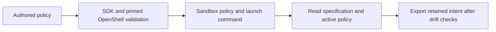

<!-- SPDX-FileCopyrightText: Copyright (c) 2026 NVIDIA CORPORATION & AFFILIATES. All rights reserved. -->
<!-- SPDX-License-Identifier: Apache-2.0 -->

# Configuring Sandbox Policy

Use `sandboxes.<name>.network.policy.explicit` to declare filesystem, process, and egress policy.
Start from [the explicit-policy example](../../examples/explicit-policy.yaml) and follow [deployment usage](../build-deploy/usage.md) to plan, apply, and export it.

Before applying, select a fresh deployment UUID, an available gateway and inference endpoint, and an immutable agent image available to the runtime.
Check that policy paths and process identities exist in that image.
Apply creates the sandbox and grants the access declared by the policy.

## Choosing a Policy

Omitting `network`, or declaring `tier: isolated`, selects the image's advertised filesystem and process defaults.
NemoClaw adds the declared inference and search endpoint grants without granting general egress.
Those managed grants use only the selected adapter's executable paths resolved during image assembly.

To grant a few more endpoints without restating the preset, add named `grants` to it:

```yaml
network:
  tier: isolated
  grants:
    documentation:
      endpoints:
        - host: docs.example.com
          port: 443
          protocol: rest
          enforcement: enforce
          rules:
            - allow:
                method: GET
                path: /docs/**
```

Each grant takes `endpoints` in the same shape as an explicit policy rule, including MCP method and tool rules.
Its optional `binaries` default to the harness's executables, like the managed inference and search grants.
Grant names can't reuse a managed grant's name, and an explicit policy can't take `grants` or `grantRefs`, since it already lists every rule.

An explicit policy replaces the entire preset.
Omit `tier` when declaring `policy.explicit` or `policyRef`; a network that sets more than one of `tier`, `policy`, and `policyRef` is rejected.
Omitted fields inside an explicit policy follow OpenShell defaults, so copy the filesystem and process settings you intend to retain.
An empty `network_policies` map grants no general egress.

The example grants `/usr/bin/curl` access to `GET /docs/**` on `docs.example.com:443`, with TLS inspection and enforcement enabled.
Replace that example destination and executable with the API and binary your workload uses.
A binary grant for curl does not grant the same access to Python or Node.js.

The input supports TCP destinations and REST, WebSocket, JSON-RPC, and MCP inspection settings.
Unknown fields and unsupported combinations are rejected.
Inline credentials, credential-provider bindings, GraphQL, and SQL policy settings are outside this configuration contract.
To attach supervisor middleware, see [Attaching Network Middleware](#attaching-network-middleware).
The pinned OpenShell parser and validator check protocol-specific rules, destination restrictions, paths, and process identities.
See the [generated field reference](../reference/configuration.md#explicitpolicy) for the complete input surface.

`landlock.compatibility: best_effort` permits startup when the host cannot enforce Landlock restrictions.
Use `hard_requirement` to require enforcement.
Kernel enforcement still requires qualification on the deployment host.

## Reusing Policies and Grants

To give several sandboxes the same policy or grant, define it once under `spec.policies` or `spec.grants` and select it by name:

```yaml
spec:
  policies:
    docs-only:
      version: 1
      filesystem_policy:
        include_workdir: false
        read_only: [/usr, /opt, /app]
        read_write: [/sandbox, /tmp]
      network_policies:
        documentation:
          name: documentation
          endpoints:
            - host: docs.example.com
              port: 443
          binaries:
            - path: /usr/bin/curl
  grants:
    github:
      endpoints:
        - host: api.github.com
          port: 443
  sandboxes:
    researcher:
      network:
        policyRef: docs-only
    writer:
      network:
        tier: isolated
        grantRefs: [github]
```

This fragment omits the deployment's other required fields.
`policyRef` applies the named policy exactly as if it were written in `policy.explicit`.
`grantRefs` adds each named grant to the isolated preset as a rule with the grant's name; a network can combine it with inline `grants` when no name appears in both.
A reference to an undefined name fails and lists the defined names.
A definition that no sandbox selects is validated but applies to none; see [the authoring rule](../build-deploy/configuration-references.md#the-authoring-rule).
The [full-featured OpenClaw example](../../examples/full-featured-openclaw.yaml) gives three sandboxes one policy.

## Runtime Filesystem Access

When an explicit policy declares `filesystem_policy`, NemoClaw checks that it permits reads of the selected harness's runtime directories.
The same checks apply to inline harnesses and `harnessRef`, separately for every sandbox.

Selected-image assessment checks the Fabric descriptor's required files, the adapter's image-owned `runtime_files`, and the runtime manifest's `required_paths`.
The packaged image declares `/opt/fabric` and `/opt/nemoclaw`; a relocated image declares its own paths.
A missing grant makes compatibility `unsupported` and fails plan; `observation_json.compatibility` names the path.
Images without runtime metadata, such as direct Bake builds, fail planning; follow [image rebuilding and selection](../build-deploy/build.md#building-agent-images).
Document parsing validates policy syntax without assuming an image layout.
These checks do not establish every path a harness reads; verify additional harness paths against the selected image before applying.

A read-only or read-write grant for the directory or a parent directory satisfies the check.
For example, `/opt` covers the runtime directories beneath it; `/opt/fabric-source` does not cover `/opt/fabric`.
Use absolute sandbox paths without `..`; validation does not resolve image symlinks or inspect the client's filesystem.
`include_workdir` does not grant access to these runtime directories.
An omitted `filesystem_policy` retains OpenShell defaults and is outside this explicit-grant check.

Each error names the required path; edit the authored policy and rerun plan.
NemoClaw does not add filesystem grants automatically.
The image catalog records adapter requirements and runtime files, not a complete filesystem or executable inventory.
These checks do not verify arbitrary policy paths, process identities in the image, Unix permissions, writable state directories, or kernel enforcement; those still require runtime verification.

## Choosing TLS Inspection and Enforcement

For an explicit endpoint with a supported application protocol, choose TLS handling and request enforcement separately:

| Endpoint setting | Behavior in the pinned OpenShell implementation |
|---|---|
| Omit `tls` | Automatic TLS detection and termination for inspectable traffic |
| `tls: skip` | Raw TCP tunnel with no TLS termination, HTTP inspection, or credential injection |
| `enforcement: enforce` | Enforce the configured application-level request rules on inspected traffic |
| `enforcement: audit`, or omit `enforcement` | Audit application-level decisions rather than block requests based on those rules |

`tls: terminate` and `tls: passthrough` are rejected by OpenShell v0.1.7.
Remove either field to keep automatic TLS handling.

Destination and executable grants still determine which connections are allowed.
An allowed raw tunnel cannot enforce encrypted HTTP methods/paths or replace a placeholder credential inside the request.
Do not choose `tls: skip` for an endpoint that relies on those controls, including the declared Brave integration's credential injection.
Use explicit `enforcement: enforce` when the policy must reject disallowed inspected requests.
The checked-in example uses that enforcement setting with automatic TLS handling.

The [pinned parser](https://github.com/NVIDIA/OpenShell/blob/ce58cf8e9b953281352d98a637e41616295b1318/crates/openshell-supervisor-network/src/l7/mod.rs) and [proxy](https://github.com/NVIDIA/OpenShell/blob/ce58cf8e9b953281352d98a637e41616295b1318/crates/openshell-supervisor-network/src/proxy.rs) define these behaviors.
The [SDK policy validator](../../crates/nemoclaw-openshell/src/policy.rs) accepts only supported field combinations; a field's presence in the schema does not bypass protocol validation.
Live enforcement and application trust on your host remain qualification requirements.
Follow [policy change constraints](#verifying-and-changing-the-configuration) before changing a deployed policy.

## Attaching Network Middleware

OpenShell supervisor middleware inspects a sandbox's admitted HTTP requests, responses, and WebSocket messages, and can allow, change, or block them.
Using a middleware service takes two steps, with different owners:

1. **Run and register the service.** Running the service is the operator's or platform's job; NemoClaw doesn't start, package, or monitor it.
   Start it before the gateway, where both the gateway and the sandbox supervisors can reach it, and keep it available: the gateway doesn't start while a registered service is unavailable.
   For a managed gateway, register it in `spec.gateway.config`; an external gateway's operator registers it in that gateway's configuration.
   Built-in middleware, such as `openshell/regex`, needs no registration.
2. **Bind it in the sandbox policy.** Add an entry to `network_middlewares` in `policy.explicit`, naming the middleware and the destination hosts it runs for.

```yaml
spec:
  gateway:
    management: managed
    config:
      openshell.supervisor.middleware:
        - name: decision-guard
          grpc_endpoint: http://guard.example.internal:50051
          allow_insecure_transport: true
          max_payload_bytes: 262144
          timeout: 500ms
  sandboxes:
    assistant:
      network:
        policy:
          explicit:
            version: 1
            network_policies:
              documentation:
                name: documentation
                endpoints:
                  - host: docs.example.com
                    port: 443
                    protocol: rest
                    enforcement: enforce
                    access: read-only
                binaries:
                  - path: /usr/bin/curl
            network_middlewares:
              guard:
                middleware: decision-guard
                order: 10
                on_error: fail_closed
                config:
                  mode: block
                endpoints:
                  include: [docs.example.com]
```

The registration's `name` is what a binding's `middleware` field refers to.
`allow_insecure_transport` permits a plaintext endpoint without authentication; use it only for local development or on a network that already authenticates callers.
The service validates its `config`, and the gateway asks it to before accepting the policy, so keep the service running when you apply.

In each binding:

- The map key names the binding in OpenShell's logs; `name` is an optional display name.
- `endpoints.include` selects admitted destination hosts, in endpoint-host syntax without a port; `endpoints.exclude` removes hosts from that selection.
  A selector that names a port, such as `api.example.com:443`, fails OpenShell's validation at plan.
- `order` sets which binding runs first when several select the same host, lowest first; orders must be unique within the policy.
- `on_error` sets what happens when the middleware can't complete its check, for example when its service is down: `fail_closed`, the default, blocks the traffic, and `fail_open` lets it continue.
  A middleware's denial blocks traffic either way, even on an `enforcement: audit` endpoint.
- A fail-closed binding can't select an endpoint with `tls: skip`, whose traffic OpenShell can't inspect.

NemoClaw checks the fields' shape and keeps each binding as written through planning, apply, refresh, and export.
The pinned OpenShell validator checks the rest, and OpenShell intercepts and enforces the traffic; NemoClaw adds no enforcement of its own.
Changing a binding is a policy change; see [Verifying and Changing the Configuration](#verifying-and-changing-the-configuration).
Changing a managed gateway's registration restarts the gateway, as other [gateway configuration](../build-deploy/usage.md#configuring-a-managed-gateway) changes do.

OpenShell describes supervisor middleware as a research preview whose policy and service contracts can change.
Its [middleware guide](https://github.com/NVIDIA/OpenShell/blob/ce58cf8e9b953281352d98a637e41616295b1318/docs/extensibility/supervisor-middleware/configure.mdx) for the pinned release describes registration fields, failure behavior, and the decisions it logs.


## Using an Upstream Proxy

OpenShell owns the workload's proxy environment and routes traffic through its policy proxy.
To chain policy-approved egress through a corporate proxy, set the proxy in the gateway's OpenShell compute-driver settings, following the [pinned upstream proxy contract](https://github.com/NVIDIA/OpenShell/blob/ce58cf8e9b953281352d98a637e41616295b1318/crates/openshell-supervisor-network/src/upstream_proxy.rs).
At this revision, chaining applies to TLS CONNECT traffic; plain HTTP still connects directly.
An external gateway's operator sets the proxy.

For a managed gateway, put the settings in the selected driver's table in [`spec.gateway.config`](../build-deploy/usage.md#configuring-a-managed-gateway):

```yaml
spec:
  gateway:
    management: managed
    runtime:
      provider: docker
    config:
      openshell.drivers.docker:
        https_proxy: http://proxy.example.com:3128
        no_proxy: .example.internal,10.0.0.0/8
```

Use `openshell.drivers.podman` for a Podman gateway, and `openshell.drivers.kubernetes` for a Kubernetes or OpenShift gateway.
OpenShell's configuration reference describes each setting for [Docker](https://github.com/NVIDIA/OpenShell/blob/ce58cf8e9b953281352d98a637e41616295b1318/docs/how-it-works/gateways/configuration.mdx#L1556-L1569), [Podman](https://github.com/NVIDIA/OpenShell/blob/ce58cf8e9b953281352d98a637e41616295b1318/docs/how-it-works/gateways/configuration.mdx#L1677-L1754) and [Kubernetes](https://github.com/NVIDIA/OpenShell/blob/ce58cf8e9b953281352d98a637e41616295b1318/docs/how-it-works/gateways/configuration.mdx#L1363-L1400).
NemoClaw passes them through unchecked; OpenShell validates them when the gateway starts.

A Kubernetes or OpenShift gateway reads proxy credentials from a Secret in the deployment's namespace, whose key holds `user:pass`.
Create the Secret there, before the first apply or after NemoClaw creates the namespace, as for [registry Secrets](../build-deploy/kubernetes.md#referencing-registry-credentials), and name it:

```yaml
spec:
  gateway:
    config:
      openshell.drivers.kubernetes:
        https_proxy: https://proxy.example.com:3128
        proxy_auth_secret_name: corporate-proxy-auth
        proxy_auth_secret_key: credentials
```

With an `http://` proxy, credentials also require `proxy_auth_allow_insecure: true`, because Basic authentication then crosses the network unencrypted.
Docker and Podman gateways read credentials and a proxy CA only from files on the gateway (`proxy_auth_file` and `proxy_ca_bundle`), and no managed gateway can receive a proxy CA; see [current limits](../resources/limits.md#security).

Adding or changing these settings on an applied deployment restarts the gateway, and the next plan replaces its Fabric sandboxes; see [Configuring a Managed Gateway](../build-deploy/usage.md#configuring-a-managed-gateway).
An offline render of the pinned chart places the Kubernetes settings in the gateway's configuration file; no managed gateway has run behind a proxy.

## Verifying and Changing the Configuration

Review the policy selected for the sandbox before applying changes; configuration admission and an agent reply are separate checks.



Use the plan/apply/export commands in [deployment usage](../build-deploy/usage.md), then reapply the exported document.
A successful unchanged reapply preserves the sandbox identity and creates no replacement.
Export compares the observed policy and launch settings with retained intent and checks that a ready sandbox has loaded the matching policy revision.
OpenShell can add filesystem grants of its own to the loaded policy revision without recording their source.
When a policy first loads, NemoClaw accepts those additions as long as every declared rule is intact, and records the loaded revision's hash; it keeps no list of OpenShell's additions.
Afterwards the loaded policy must keep that hash: any change, including new additions, or an incomplete observation stops export and preserves state.
OpenShell v0.1.7 applies GPU filesystem additions inside the workload without writing them back to the gateway policy.
This removes the upstream cause of suspected GPU false drift; live GPU export and reapply remain unverified.
Missing policy observations or drift do not produce a partial configuration.

A policy change replaces the sandbox, deleting its files and conversations (except on [mounted volumes](../build-deploy/state.md#keeping-agent-files-on-mounted-volumes)); back them up first.
External OpenShell policy edits conflict with the declared policy and stop export; change the policy in the YAML instead.
Retained workspace and model storage follow the existing lifecycle rules.
If an operation fails, preserve the state directory, resolve the reported observation or configuration problem, and retry with the retained configuration.

### Recovering from Runtime Policy Rejection

If OpenShell reports configuration admission as rejected, apply stops its startup wait and reports `sandbox/<name>: OpenShell configuration rejected`, followed by a safe reason.
This check applies while the sandbox is starting and before the agent starts.
Known gateway diagnostics identify policy, attached-provider, or middleware repair; unrecognized text becomes a fixed configuration-repair message.
The error does not include raw supervisor parser output.
A sandbox that has not reported rejection still follows the startup wait.

Preserve the state directory: failed apply retains created resource bindings.
If the problem is an attached-provider or credential configuration that can be repaired without replacing the sandbox, correct it and reapply using the retained state.
Apply can deliver that repair; completion still requires OpenShell to accept the configuration.
If the authored sandbox policy must change, change it and apply; that replaces the sandbox, deleting its files and conversations (except on mounted volumes).
Destroy remains available after the failed first apply and does not require successful admission or readiness.

Local fixture tests exercise creation, rejection, drift detection, and export/reapply behavior.
They do not establish proxy reachability or kernel enforcement on a live host.
